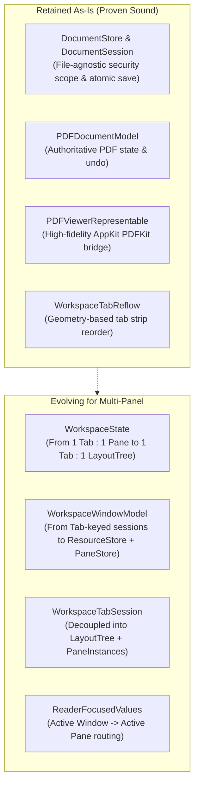
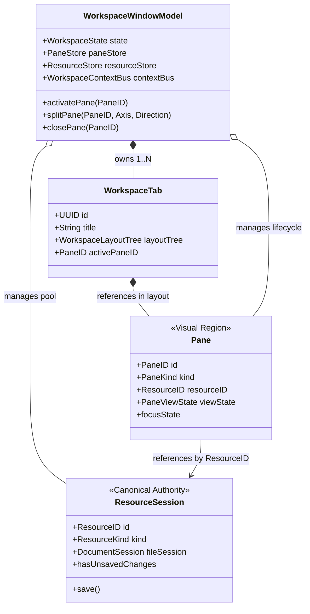
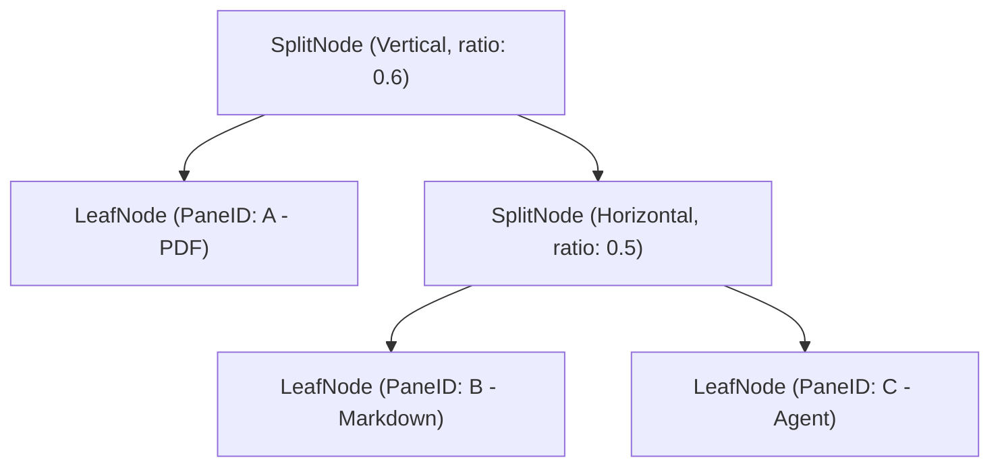
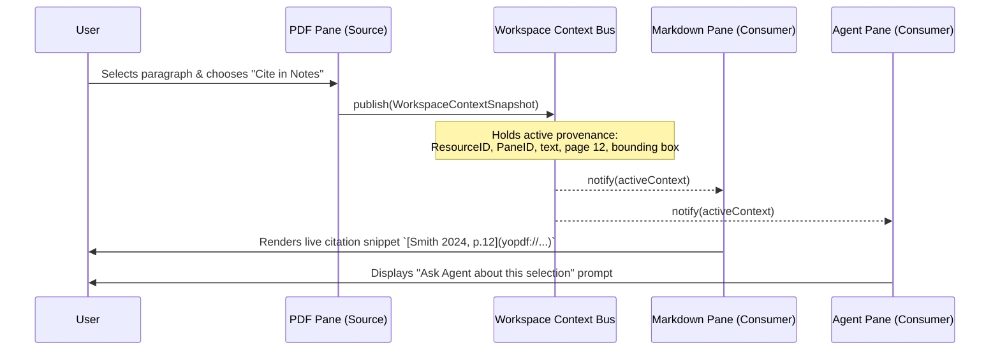
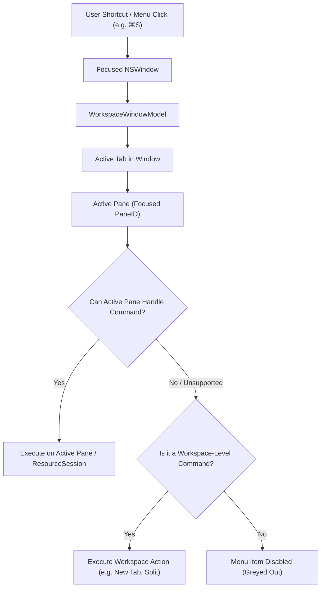
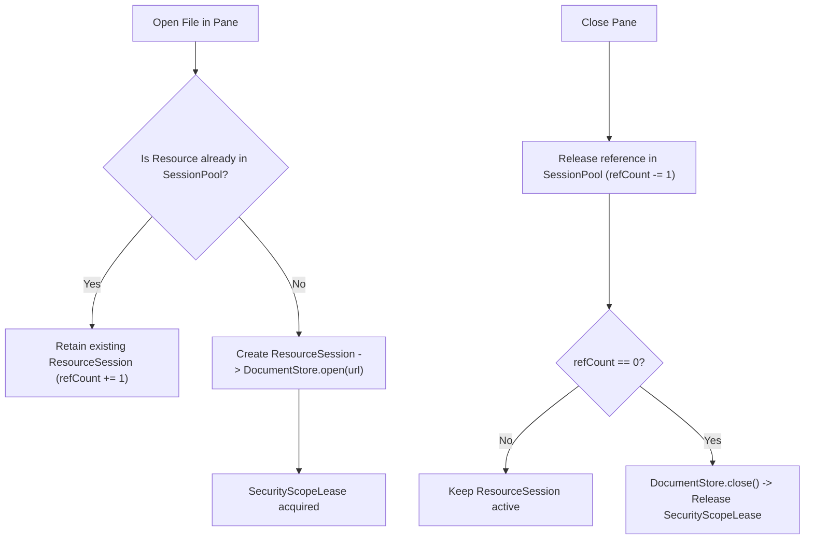

# YoPDF Heterogeneous Multi-Panel Research Workspace Architecture Contract

**Status**: Proposed Architecture Contract  
**Document Version**: 1.0.0  
**Target Platform**: macOS 14.0+ (Sonoma), Apple Silicon & Intel  
**Author**: Senior macOS Architect, YoPDF Core Team  
**Date**: November 2026  
**Scope**: Architecture & Contract Specification (Non-Implementation)

---

## 1. Executive Summary

### 1.1 The Product Vision

YoPDF is evolving beyond a standalone PDF reader into a unified **Multi-Panel Research Workspace**.

> *"YoPDF is not a collection of separate tools inside a window. It is a workspace where heterogeneous content types—PDFs, research notes, reference figures, web literature, and autonomous agents—work together around a research task."*

In modern academic, scientific, and professional knowledge work, reading a PDF never happens in isolation. A researcher reads an empirical paper, cross-examines a cited methodology in a browser, excerpts key equations and diagrams into a structured Markdown paper note, inspects high-resolution microscopy or architecture figures, and consults an AI research agent to synthesize complex arguments. Today, users juggle multiple disconnected applications (Preview/Acrobat, Obsidian/Notion, Chrome/Safari, Cursor/Claude), continually losing mental context, copy-pasting unstructured text, and losing document provenance.

YoPDF solves this by providing a native, local-first, multi-panel workspace where heterogeneous panels collaborate seamlessly through typed research context, while preserving strict data ownership, offline capability, and native macOS fidelity.

### 1.2 Architectural Thesis

To support heterogeneous panels without destabilizing YoPDF's existing rock-solid PDF foundation, the architecture establishes a strict **Three-Tier Decoupling Principle**:

```
+-----------------------------------------------------------------------------------+
|                                     WORKSPACE                                     |
|    Window Lifecycle | Tab Strip | Binary Split Layout Tree | Active Selection     |
+-----------------------------------------------------------------------------------+
                                          |
                      Hosts 1..N Visual Panes (Polymorphic)
                                          v
+-----------------------------------------------------------------------------------+
|                                       PANE                                        |
|  Stable PaneID | Visual Viewport State (Zoom/Page/Scroll) | Command Focus Adapter |
+-----------------------------------------------------------------------------------+
                                          |
                    References 1 Underlying Resource via Session
                                          v
+-----------------------------------------------------------------------------------+
|                                 RESOURCE / SESSION                                |
|   Canonical Identity | In-Memory Document Model | Persistence & File Leasing      |
+-----------------------------------------------------------------------------------+
```

1. **Workspace Tier**: Manages windows, tabs, layout geometry (binary split tree), active pane focus, and cross-pane context routing. It knows nothing about PDFKit, WKWebView, or Markdown text engines.
2. **Pane Tier**: A lightweight, visual viewport region inside a split. It owns viewport-specific state (scroll offset, zoom scale, active page index, search highlight) and routes user commands to its underlying session. Multiple Panes can reference the **same** Resource.
3. **Resource / Session Tier**: Represents the authoritative source of truth for the underlying entity (local PDF file, local Markdown note, local figure image, remote URL, or local Agent conversation). It owns file security scopes, data persistence, atomic staging, autosave debounce, and modification dirty flags.

### 1.3 Scope and Non-Goals

- **In Scope**:
  - Formalizing the mathematical invariants and data models of the binary split layout tree.
  - Decoupling visual Panes from runtime Resource Sessions.
  - Defining the typed `WorkspaceContext` mechanism for cross-pane citation and research operations.
  - Defining active-pane responder chain and command routing semantics.
  - Designing a staged, backward-compatible migration path from P0-B through P1-B.
  - Evaluating `quiet-md` (`fdl_core`) for Markdown note integration.
- **Strictly Out of Scope**:
  - Feature implementation of Markdown editor, Browser, Image, or Agent Panes.
  - Refactoring existing working code in this task.
  - Introducing third-party dependencies or Rust FFI bindings.
  - Altering P0-B toolbar, context menu, or drag-and-drop functional requirements.

---

## 2. Current Architecture Audit

### 2.1 Inventory of What Is Implemented (Main Branch)

| Subsystem | Existing Abstraction | Current Role & Responsibilities |
| :--- | :--- | :--- |
| **Tab Ordering & Selection** | `WorkspaceTabIdentity`<br>`WorkspaceState` | Pure value-type state (`Sendable`, `Equatable`). Manages `tabs: [WorkspaceTabIdentity]` and `activeTabID: UUID?`. Enforces cyclic keyboard switching (`⇧⌘[` / `⇧⌘]`), insertion, closure, and drag reflow (`WorkspaceTabReflow`). |
| **Window Runtime Owner** | `WorkspaceWindowModel` | `@MainActor ObservableObject` owning `sessions: [UUID: WorkspaceTabSession]`. Coordinates document and draft dirty revisions, close prompts (`ReaderPromptPolicy`), unsaved changes lifecycle, and Finder file open requests. |
| **Tab Session** | `WorkspaceTabSession` | Identifiable container bundling 1 tab ID, 1 pane ID, 1 `PDFDocumentModel`, 1 `NoteComposerStore`, 1 `PDFSearchSession`, and 1 `ReaderNavigationState`. **Strict 1:1 tab-to-pane-to-document binding.** |
| **File I/O & Security** | `DocumentStore`<br>`DocumentSession` | File-agnostic byte-level reader/writer. Manages `SecurityScopeLease`, atomic staging writes via `replaceItemAt`, optimistic version checks (`DocumentVersion`), conflict classification (`ExternalChange`), and rollback safety. |
| **Document State** | `PDFDocumentModel`<br>`PDFDocumentModel+Editing` | Authoritative PDF runtime owner. Encapsulates `PDFDocument`, page indices, zoom scales, text selections (`PDFSelection`), markup annotations (`PDFAnnotation`), custom undo/redo stacks (`markupUndoStack`), and debounce autosave (`autoSaveTask`). |
| **AppKit Bridge** | `PDFViewerRepresentable`<br>`MarkupPDFView` | `NSViewRepresentable` bridging Apple `PDFView` into SwiftUI. Translates coordinate systems, anchors note popovers, handles overlay rendering and hit testing. |
| **Command Routing** | `PDFReaderCommands`<br>`ReaderFocusedValues` | Declares menu-bar commands using SwiftUI `@FocusedValue` keys (e.g., `\.documentModel`, `\.saveDocument`, `\.findInDocument`). Resolves commands against the frontmost window. |

### 2.2 What Is Currently Under Development: P0-B

As established in [`Docs/P0-B-DRAG-DROP-REQUIREMENTS.md`](file:///Users/lj/Downloads/YoPDF/Docs/P0-B-DRAG-DROP-REQUIREMENTS.md), P0-B expands YoPDF from single-pane tabs into split-pane tabs. P0-B defines strict release requirements:
1. **Three Entry Points**:
   - Toolbar: `Split Right` / `Split Down`.
   - Context Menu: `Open in Split Right` / `Open in Split Down`.
   - Drag & Drop: Dragging a pane titlebar, a single-pane tab, or an external PDF file from Finder.
2. **Four Drop Zones**: `Left`, `Right`, `Top`, `Bottom` with semi-transparent layout previews.
3. **Core Semantic Invariants**:
   - Moving a pane moves the **existing session** without re-reading the file or losing state.
   - Preserves zoom scale, page index, search state, annotation history, and uncommitted note drafts.
   - Prevents two uncoordinated editable sessions for the same file.
   - Dragging a Finder file performs validation before committing layout mutations.
   - Maximum pane count limits and minimum pane dimensions are strictly enforced.

### 2.3 Abstraction Retention vs. Evolution Matrix



1. **Abstractions Retained As-Is**:
   - `DocumentStore` & `DocumentSession`: Beautifully designed and 100% file-agnostic. Operates on byte arrays, file URLs, and security leases. It will serve Markdown notes and image files without structural changes.
   - `PDFDocumentModel`: Remains the definitive model for PDF documents, annotation stacks, and PDFKit interactions.
   - `PDFViewerRepresentable`: Remains the view representable for the PDF pane.
   - `WorkspaceTabReflow`: Remains the calculation engine for tab strip dragging.

2. **Abstractions That Must Evolve**:
   - `WorkspaceTabIdentity`: Currently assumes `id: UUID` and `paneID: UUID` (1-to-1). It must evolve so each tab owns a `WorkspaceLayoutTree`.
   - `WorkspaceState`: Must maintain tab order while delegating panel geometry to a serializable `WorkspaceLayoutTree` per tab. Must track both `activeTabID` and per-tab `activePaneID`.
   - `WorkspaceTabSession`: Must be decomposed. In a multi-panel workspace, a tab is not a single document session. It is an arrangement of Panes referencing Resource Sessions.
   - `ReaderFocusedValues`: Currently binds window-level properties directly to `PDFDocumentModel`. It must route commands to the **Active Pane's responder**.

3. **Backward Compatibility Invariants**:
   - Single-tab, single-PDF workflows must behave identically to the existing shipping product.
   - Serialized layouts that contain only a single PDF pane must deserialize into a single-pane tree without migration errors.
   - Existing keyboard shortcuts (`⇧⌘[` / `⇧⌘]`, `⌘W`, `⌘S`, `⌘F`) must retain identical behavior.

---

## 3. Core Architecture: Separation of Concerns

The architecture strictly distinguishes three core concepts: **Workspace**, **Pane**, and **Resource / Session**.



### 3.1 Workspace

The Workspace represents the top-level container associated with an `NSWindow`.

**Responsibilities**:
- Window-level coordination, window closing guards (`WindowCloseGuard`), and Finder open event routing (`FileOpenRequestQueue`).
- Tab strip management (creation, activation, reordering, close prompts).
- Housing the **Binary Split Layout Tree** for the active tab.
- Maintaining the **Active Pane ID** (`activePaneID`).
- Persisting and restoring window layout configurations.
- Hosting the **Workspace Context Bus** for inter-pane communication.

### 3.2 Pane

A Pane is a visual, interactive rectangular region inside the workspace layout tree.

**Responsibilities**:
- Displaying the visual presentation of a resource (via `PDFPaneView`, `MarkdownPaneView`, `ImagePaneView`, `BrowserPaneView`, or `AgentPaneView`).
- Owning **Viewport-Specific State** (`PaneViewState`):
  - Current visible page / scroll position.
  - Viewport zoom scale and auto-scale mode.
  - Active search highlights and local find bar visibility.
  - Selection ranges within this specific view.
- Hosting the first-responder adapter that connects user keyboard events to the appropriate command handlers.
- Publishing user interactions (text selection, citation clicks) to the Workspace Context Bus.

**Invariants**:
- Every Pane has a globally unique, stable `PaneID: UUID`.
- A Pane never directly touches disk files or manages security-scoped URLs; it communicates strictly through its associated `ResourceSession`.
- The layout engine knows nothing about the internal UI of the Pane (pure dependency inversion).

### 3.3 Resource and Session

A **Resource** represents the content entity itself, independent of visual presentation:
- A local PDF file (`.pdf`).
- A local Markdown file (`.md`).
- A local image file (`.png`, `.jpg`, `.svg`).
- A remote web URL (`https://...`).
- An autonomous Agent conversation session.

A **ResourceSession** represents the runtime authority and ownership of an opened resource:
- **Canonical File Authority**: Owns the `DocumentSession`, holding the single active `SecurityScopeLease` for local files.
- **Data Model Ownership**: Owns in-memory data structures (e.g., `PDFDocument`, Markdown abstract syntax tree, or Agent message history).
- **Modification Coordination**: Coordinates dirty tracking (`hasUnsavedChanges`), undo/redo history stacks, staging writes, and autosave debouncing.
- **Multi-Pane Reference Handling**: Multiple Panes can point to the same `ResourceID`. For example:
  - Two PDF Panes can display the *same* PDF file at different pages (e.g., page 3 methodology vs. page 18 appendix).
  - Both Panes reference the **same** `PDFResourceSession`.
  - When Pane A adds a highlight annotation on page 3, the underlying `PDFResourceSession` mutates, dirty state is bumped, and Pane B is notified to update if displaying overlapping content.
  - **Crucial Rule**: Opening the same file in two Panes *never* creates two conflicting `DocumentSession` instances. Dual uncoordinated editable instances are physically impossible under this architecture.

### 3.4 Shared State vs. Pane-Specific State Matrix

| State Property | Scope | Owner | Multi-Pane Behavior |
| :--- | :--- | :--- | :--- |
| **Security Scope Lease** | Shared | `ResourceSession` | Acquired once on open, released when last Pane closes. |
| **Raw Content / In-Memory Model** | Shared | `ResourceSession` | Single model (`PDFDocument`, AST). All panes observe it. |
| **Annotation History / Undo Stack** | Shared | `ResourceSession` | Shared edit timeline. Undo reverses last mutation on the file. |
| **Unsaved Edits / Dirty Flag** | Shared | `ResourceSession` | Aggregated at window level. Triggers single save operation. |
| **Autosave Debounce Task** | Shared | `ResourceSession` | Single writer task writes to disk via staging file. |
| **Current Page / Scroll Offset** | Pane-Specific | `PaneViewState` | Independent. Pane 1 can be on Page 1; Pane 2 on Page 50. |
| **Zoom Scale / Magnification** | Pane-Specific | `PaneViewState` | Independent. Pane 1 can be "Fit Width", Pane 2 at "200%". |
| **Sidebar Visibility / Tab** | Pane-Specific | `PaneViewState` | Independent. Pane 1 can show Thumbnails; Pane 2 hides sidebar. |
| **Local Search Filter / Match Index** | Pane-Specific | `PaneViewState` | Independent search sessions per pane. |
| **Web Navigation History** | Resource/Pane | `BrowserSession` | Independent per browser instance (isolated back/forward list). |

---

## 4. Proposed Data Models

The following Swift data structures define the foundation of the Heterogeneous Multi-Panel architecture in `YoPDFCore`.

### 4.1 Identifiers and Resource Descriptors

```swift
import Foundation

/// Stable, unique identifier for a visual layout region.
public struct PaneID: Hashable, Identifiable, Sendable, Codable {
    public let rawValue: UUID
    public var id: UUID { rawValue }

    public init(rawValue: UUID = UUID()) {
        self.rawValue = rawValue
    }
}

/// Stable, unique identifier for an underlying content resource.
public struct ResourceID: Hashable, Identifiable, Sendable, Codable {
    public let rawValue: UUID
    public var id: UUID { rawValue }

    public init(rawValue: UUID = UUID()) {
        self.rawValue = rawValue
    }
}

/// Content categories supported across YoPDF workspaces.
public enum PaneKind: String, Codable, Sendable, CaseIterable {
    case pdf
    case markdown
    case image
    case browser
    case agent
}

/// Persistent descriptor of a content resource.
public enum ResourceDescriptor: Equatable, Sendable, Codable {
    /// Local document file (PDF, Markdown, Image) referenced by security bookmark.
    case localFile(url: URL, bookmarkData: Data?, kind: PaneKind)
    /// Remote or local web destination.
    case webURL(url: URL)
    /// Agent conversation referenced by session ID.
    case agentSession(conversationID: UUID, title: String)
    /// Ephemeral or new untitled document.
    case untitled(kind: PaneKind, temporaryID: UUID)
}
```

### 4.2 Pane Descriptor and View State

```swift
/// Serializable snapshot of a Pane's visual configuration.
public struct PaneDescriptor: Identifiable, Equatable, Sendable, Codable {
    public let id: PaneID
    public let kind: PaneKind
    public var resourceID: ResourceID
    public var viewState: PaneViewState

    public init(
        id: PaneID = PaneID(),
        kind: PaneKind,
        resourceID: ResourceID,
        viewState: PaneViewState
    ) {
        self.id = id
        self.kind = kind
        self.resourceID = resourceID
        self.viewState = viewState
    }
}

/// Viewport-specific state preserved across splits, tab switches, and app restarts.
public enum PaneViewState: Equatable, Sendable, Codable {
    case pdf(PDFPaneViewState)
    case markdown(MarkdownPaneViewState)
    case image(ImagePaneViewState)
    case browser(BrowserPaneViewState)
    case agent(AgentPaneViewState)
}

public struct PDFPaneViewState: Equatable, Sendable, Codable {
    public var pageIndex: Int
    public var zoomScale: Double
    public var isAutoScaling: Bool
    public var sidebarVisible: Bool
    public var sidebarSection: String // "outline", "thumbnails", "annotations"
    
    public init(
        pageIndex: Int = 0,
        zoomScale: Double = 1.0,
        isAutoScaling: Bool = true,
        sidebarVisible: Bool = false,
        sidebarSection: String = "outline"
    ) {
        self.pageIndex = pageIndex
        self.zoomScale = zoomScale
        self.isAutoScaling = isAutoScaling
        self.sidebarVisible = sidebarVisible
        self.sidebarSection = sidebarSection
    }
}

public struct MarkdownPaneViewState: Equatable, Sendable, Codable {
    public var scrollLine: Int
    public var cursorByteOffset: Int
    public var isPreviewMode: Bool
    
    public init(scrollLine: Int = 0, cursorByteOffset: Int = 0, isPreviewMode: Bool = false) {
        self.scrollLine = scrollLine
        self.cursorByteOffset = cursorByteOffset
        self.isPreviewMode = isPreviewMode
    }
}

public struct ImagePaneViewState: Equatable, Sendable, Codable {
    public var zoomScale: Double
    public var panOffset: CGPoint
    
    public init(zoomScale: Double = 1.0, panOffset: CGPoint = .zero) {
        self.zoomScale = zoomScale
        self.panOffset = panOffset
    }
}

public struct BrowserPaneViewState: Equatable, Sendable, Codable {
    public var currentURL: URL?
    public var canGoBack: Bool
    public var canGoForward: Bool
    
    public init(currentURL: URL? = nil, canGoBack: Bool = false, canGoForward: Bool = false) {
        self.currentURL = currentURL
        self.canGoBack = canGoBack
        self.canGoForward = canGoForward
    }
}

public struct AgentPaneViewState: Equatable, Sendable, Codable {
    public var conversationID: UUID
    public var scrollPosition: Double
    
    public init(conversationID: UUID = UUID(), scrollPosition: Double = 0.0) {
        self.conversationID = conversationID
        self.scrollPosition = scrollPosition
    }
}
```

---

## 5. Binary Split Layout Tree Design

To ensure high performance, mathematical determinism, and seamless serialization, YoPDF adopts a **Binary Split Tree** (`WorkspaceLayoutTree`).

### 5.1 Tree Structure



```swift
/// Axis along which a container split separates its children.
public enum SplitAxis: String, Codable, Sendable {
    /// Left and Right sub-panes separated by a vertical divider.
    case horizontal
    /// Top and Bottom sub-panes separated by a horizontal divider.
    case vertical
}

/// Recursive binary layout tree representation.
public indirect enum LayoutNode: Equatable, Sendable, Codable {
    /// Terminal node hosting a single visual pane.
    case leaf(PaneID)
    
    /// Recursive split node dividing space between first and second children.
    case split(
        axis: SplitAxis,
        ratio: Double, // Clamped between 0.05 and 0.95 (default 0.5)
        first: LayoutNode,
        second: LayoutNode
    )
}

/// Authoritative layout representation for one workspace tab.
public struct WorkspaceLayoutTree: Equatable, Sendable, Codable {
    public private(set) var root: LayoutNode
    
    public init(leaf: PaneID) {
        self.root = .leaf(leaf)
    }
    
    public init(root: LayoutNode) {
        self.root = root
    }
}
```

### 5.2 Split Invariants and Operational Rules

1. **Unique Pane ID Invariant**: Every `PaneID` must appear at most once across the entire tree. Duplicate `PaneID`s are rejected at model insertion.
2. **Normalized Split Ratio Invariant**: The split ratio `r` must satisfy $0.05 \le r \le 0.95$. A ratio of $0.5$ represents an even 50/50 division. Ratios outside this range are clamped during resizing and normalized during deserialization.
3. **No Orphaned or Empty Branch Invariant**: Every `.split` node must have valid `.first` and `.second` subtrees. When a pane is removed:
   - If a leaf is removed from a `.split`, the split node collapses immediately into the surviving sibling.
   - Example: `split(first: leaf(A), second: leaf(B))` upon removing `B` collapses directly into `leaf(A)`.
4. **Active Pane Validity Invariant**: The tab's `activePaneID` must always resolve to an existing `.leaf(PaneID)` in the tree. If the active pane is closed, focus transfers to the nearest adjacent sibling according to in-order tree traversal.
5. **Pane Count Limits**:
   - For Phase P0-B, the maximum number of simultaneous panes per tab is limited to **4** (or up to 6 on extra-large displays) to preserve readability and system responsiveness.
   - Any split operation that would exceed this threshold is refused, returning a specific diagnostic error (`LayoutMutationError.maximumPaneLimitReached`).
6. **Minimum Dimension Constraints**:
   - Minimum Pane Width: **360 pt**.
   - Minimum Pane Height: **280 pt**.
   - If the parent window dimension along the requested split axis is insufficient to satisfy $2 \times \text{minimum dimension} + \text{divider width}$, the split operation is rejected with user feedback (`LayoutMutationError.insufficientSpace`).

### 5.3 Tree Mutation Operations

The `WorkspaceLayoutTree` provides purely functional, non-destructive mutation methods:

```swift
public enum LayoutInsertionDirection: Sendable {
    case left, right, top, bottom
}

public enum LayoutMutationError: Error, Equatable, Sendable {
    case targetPaneNotFound(PaneID)
    case duplicatePaneID(PaneID)
    case maximumPaneLimitReached(Int)
    case cannotCloseOnlyPane
}

extension WorkspaceLayoutTree {
    /// Inserts `newPane` adjacent to `targetPane` along the specified direction.
    public func inserting(
        _ newPane: PaneID,
        relativeTo targetPane: PaneID,
        direction: LayoutInsertionDirection,
        maxPanes: Int = 4
    ) -> Result<WorkspaceLayoutTree, LayoutMutationError> {
        guard !allPaneIDs.contains(newPane) else {
            return .failure(.duplicatePaneID(newPane))
        }
        guard allPaneIDs.count < maxPanes else {
            return .failure(.maximumPaneLimitReached(maxPanes))
        }
        guard allPaneIDs.contains(targetPane) else {
            return .failure(.targetPaneNotFound(targetPane))
        }
        
        let axis: SplitAxis = (direction == .left || direction == .right) ? .horizontal : .vertical
        let isFirst = (direction == .left || direction == .top)
        
        let updatedRoot = root.replacing(targetPane) { targetNode in
            let newLeaf = LayoutNode.leaf(newPane)
            return LayoutNode.split(
                axis: axis,
                ratio: 0.5,
                first: isFirst ? newLeaf : targetNode,
                second: isFirst ? targetNode : newLeaf
            )
        }
        return .success(WorkspaceLayoutTree(root: updatedRoot))
    }
    
    /// Removes a pane from the layout. Collapses parent split nodes automatically.
    public func removing(_ pane: PaneID) -> Result<WorkspaceLayoutTree, LayoutMutationError> {
        guard allPaneIDs.count > 1 else {
            return .failure(.cannotCloseOnlyPane)
        }
        guard allPaneIDs.contains(pane) else {
            return .failure(.targetPaneNotFound(pane))
        }
        
        guard let pruned = root.pruning(pane) else {
            return .failure(.cannotCloseOnlyPane)
        }
        return .success(WorkspaceLayoutTree(root: pruned))
    }
    
    /// Collects all active PaneIDs in in-order layout sequence.
    public var allPaneIDs: [PaneID] {
        root.collectPaneIDs()
    }
}
```

---

## 6. Workspace Context and Cross-Pane Collaboration

In a multi-panel research environment, panels must collaborate without tight coupling. For example, selecting text in a PDF must allow:
1. Markdown Pane to insert a structured bibliographic citation with source anchor.
2. Web Browser Pane to run an academic literature search on the selected keywords.
3. Agent Pane to analyze the methodology or explain the highlighted passage.
4. Companion PDF Pane to jump to cited page numbers or bibliographies.

### 6.1 Architecture of the Workspace Context Bus



### 6.2 Data Model: Research Context and Provenance

```swift
/// An immutable snapshot of user research focus published by an active Pane.
public struct WorkspaceContextSnapshot: Identifiable, Equatable, Sendable {
    public let id: UUID
    public let timestamp: Date
    public let sourcePaneID: PaneID
    public let sourceResourceID: ResourceID
    public let sourceKind: PaneKind
    
    /// User-selected text or excerpt.
    public let selectionText: String?
    
    /// Spatial or structural anchor for deep linking and provenance.
    public let anchor: SelectionAnchor?
    
    /// Associated resource metadata (e.g. PDF title, DOI, author, webpage URL).
    public let metadata: ContextMetadata
    
    public init(
        sourcePaneID: PaneID,
        sourceResourceID: ResourceID,
        sourceKind: PaneKind,
        selectionText: String?,
        anchor: SelectionAnchor?,
        metadata: ContextMetadata
    ) {
        self.id = UUID()
        self.timestamp = Date()
        self.sourcePaneID = sourcePaneID
        self.sourceResourceID = sourceResourceID
        self.sourceKind = sourceKind
        self.selectionText = selectionText
        self.anchor = anchor
        self.metadata = metadata
    }
}

/// Structural anchor defining where in the source document the context originated.
public enum SelectionAnchor: Equatable, Sendable, Codable {
    /// PDF anchor: 0-based page index, normalized page rect [0..1, 0..1].
    case pdfPage(pageIndex: Int, bounds: CGRect?)
    /// Markdown anchor: Line range and heading hierarchy.
    case markdownLine(lineIndex: Int, headingPath: [String])
    /// Web anchor: URL and optional CSS selector or text fragment.
    case webAnchor(url: URL, textFragment: String?)
}

public struct ContextMetadata: Equatable, Sendable, Codable {
    public var title: String
    public var fileURL: URL?
    public var doi: String?
    public var authorString: String?
    
    public init(title: String, fileURL: URL? = nil, doi: String? = nil, authorString: String? = nil) {
        self.title = title
        self.fileURL = fileURL
        self.doi = doi
        self.authorString = authorString
    }
}
```

### 6.3 Rules of Inter-Pane Communication

1. **No Direct UI Coupling**: A `PDFPaneView` never imports or instantiates a `MarkdownEditorView`, and vice-versa. All interactions go through `WorkspaceContextBus`.
2. **Explicit User Authorization**: An Agent Pane or companion pane can *never* silently execute mutations (such as inserting text or modifying annotations) without explicit user confirmation or deliberate gesture trigger.
3. **Deep Link Navigation URI (`yopdf://`)**:
   - YoPDF generates deterministic deep links for citations:
     `yopdf://open?file=<escaped_path>&page=12&rect=0.2,0.4,0.6,0.1`
   - Clicking this citation in a Markdown Pane instructs the Workspace to focus or split the referenced PDF Pane and navigate to Page 12 with highlighted coordinates.

---

## 7. Command Routing and Responder Lifecycle

In a multi-panel workspace, the system must deterministically route menu commands (`⌘S` Save, `⌘Z` Undo, `⌘F` Find, `⌘+` Zoom In, `⌘W` Close) to the correct target.

### 7.1 Active Pane Determination and Responder Hierarchy



1. **Focus Tracking**:
   - Each visual Pane registers an AppKit/SwiftUI focus monitor.
   - Clicking anywhere inside a Pane's bounds sets it as the Workspace's `activePaneID`.
   - The active pane displays a subtle, native 1.5pt accent border or titlebar highlight, providing unambiguous visual feedback to the user.
2. **SwiftUI FocusedValue Architecture Evolution**:
   - The current `ReaderFocusedValues` binds directly to `PDFDocumentModel?`.
   - Under the multi-panel architecture, `FocusedValues` exposes a generic **Pane Command Adapter**:

```swift
/// Protocol implemented by each pane's active controller.
@MainActor
public protocol PaneCommandResponder: AnyObject {
    var paneID: PaneID { get }
    var paneKind: PaneKind { get }
    
    // File operations
    var canSave: Bool { get }
    func save()
    var canSaveAs: Bool { get }
    func saveAs()
    
    // Edit operations
    var canUndo: Bool { get }
    func undo()
    var canRedo: Bool { get }
    func redo()
    
    // Search operations
    var canFind: Bool { get }
    func find()
    
    // Viewport operations
    var canZoom: Bool { get }
    func zoomIn()
    func zoomOut()
    func resetZoom()
}
```

3. **Routing Table by Command**:

| Command | Menu Equivalent | Routing Target | Behavior & Fallback |
| :--- | :--- | :--- | :--- |
| **Save** | `⌘S` | Active Pane's `ResourceSession` | Saves active document to disk. If active pane is Browser/Agent, command is disabled. |
| **Save As…** | `⇧⌘S` | Active Pane's `ResourceSession` | Presents NSSavePanel for active document. |
| **Undo / Redo**| `⌘Z` / `⇧⌘Z` | Active Pane's Undo Stack | Dispatched to active pane's undo coordinator. |
| **Find in Document**| `⌘F` | Active Pane | Opens in-pane search bar for PDF, Markdown, or Browser. |
| **Zoom In / Out**| `⌘+` / `⌘-` | Active Pane | Modifies active pane's `zoomScale`. |
| **Close Pane** | `⇧⌘W` | Active Pane | Closes active pane; prunes layout tree. Prompts if unsaved edits exist. |
| **Close Tab** | `⌘W` | Active Tab | Closes active tab. Prompts for unsaved edits across all panes in tab. |

---

## 8. Persistence and Restoration Architecture

### 8.1 Serialization Schema

The workspace layout and tab sessions are persisted to disk (under `~/Library/Application Support/YoPDF/workspaces/` or via native macOS `NSWindowRestoration`) using `Codable` JSON representations:

```json
{
  "version": 1,
  "windowID": "main-reader-window",
  "activeTabID": "E8C44A12-3498-4B11-8C52-25983A11C901",
  "tabs": [
    {
      "id": "E8C44A12-3498-4B11-8C52-25983A11C901",
      "title": "Attention Is All You Need.pdf",
      "activePaneID": "41E7A7A3-A2D0-4054-9471-2B47AC7E1410",
      "layoutTree": {
        "axis": "horizontal",
        "ratio": 0.55,
        "first": {
          "leaf": "41E7A7A3-A2D0-4054-9471-2B47AC7E1410"
        },
        "second": {
          "leaf": "C871850E-1647-4950-A03C-DC481B55B099"
        }
      },
      "panes": [
        {
          "id": "41E7A7A3-A2D0-4054-9471-2B47AC7E1410",
          "kind": "pdf",
          "resourceID": "F08827A1-8012-4BD8-A4AA-01B981C1B001",
          "viewState": {
            "pageIndex": 4,
            "zoomScale": 1.25,
            "isAutoScaling": false,
            "sidebarVisible": true,
            "sidebarSection": "outline"
          }
        },
        {
          "id": "C871850E-1647-4950-A03C-DC481B55B099",
          "kind": "markdown",
          "resourceID": "B29104A4-1029-4CE3-B928-11A04499E002",
          "viewState": {
            "scrollLine": 45,
            "cursorByteOffset": 820,
            "isPreviewMode": false
          }
        }
      ]
    }
  ],
  "resources": [
    {
      "id": "F08827A1-8012-4BD8-A4AA-01B981C1B001",
      "descriptor": {
        "type": "localFile",
        "kind": "pdf",
        "url": "file:///Users/researcher/Papers/attention.pdf",
        "bookmarkData": "Ym9va21hcmsxMjM..."
      }
    },
    {
      "id": "B29104A4-1029-4CE3-B928-11A04499E002",
      "descriptor": {
        "type": "localFile",
        "kind": "markdown",
        "url": "file:///Users/researcher/Notes/attention_notes.md",
        "bookmarkData": "Ym9va21hcms0NTY..."
      }
    }
  ]
}
```

### 8.2 Safe Restoration and Graceful Degradation Rules

1. **Missing or Inaccessible Files**:
   - If a local file has moved or permissions expired, the system attempts resolution via stored security-scoped bookmarks.
   - If bookmark resolution fails:
     - The Pane is **not** silently deleted (which would destroy user workspace geometry).
     - Instead, the Pane renders an informative **Placeholder State**: *"Document Unavailable: [File Name]. Click to Relink or Close Pane."*
2. **Corrupted Layout Trees**:
   - If a deserialized layout tree contains orphaned leaves or duplicate PaneIDs, the layout validator repairs the tree by removing invalid branches and falling back to a safe single-pane layout.
3. **Empty Pane Prevention**:
   - Closing the final remaining pane in a tab closes the tab, exactly matching terminal/browser UX.
   - Closing the final tab leaves a fresh, empty workspace ready for document opening.

---

## 9. Security, Privacy, and Resource Lifecycle

### 9.1 Security Scope Lease Management

In macOS App Sandbox, reading files outside the container requires explicit security-scoped URLs (`startAccessingSecurityScopedResource()`). In a multi-panel workspace where multiple panes can point to the same file, security scope leaks or premature revocation must be avoided.



**Lifecycle Invariants**:
- The `ResourceSessionPool` maintains an exact reference count of active Panes observing each `ResourceID`.
- A security scope is opened **exactly once** upon initial load.
- When Pane 1 opens `paper.pdf` and Pane 2 subsequently splits `paper.pdf`, Pane 2 merely acquires a retain count on the existing `ResourceSession`.
- Closing Pane 1 decrements the count to 1; file access remains active for Pane 2.
- Only when the last referencing Pane closes is `DocumentSession.close()` invoked, safely releasing the security scope.

### 9.2 PDF and Untrusted Content Sanitization

1. **Executable Code Prohibition**: PDF files and Markdown notes are untrusted inputs. Embedded JavaScript, launch actions, or external system commands in PDFs are unconditionally stripped or ignored.
2. **Web Browser Isolation**:
   - The Browser Pane utilizes `WKWebView` with strict non-persistent data storage (`WKWebsiteDataStore.nonPersistent()`) or custom privacy profiles.
   - Cross-site script access and local file system access (`allowFileAccessFromFileURLs = false`) are disabled.
3. **Agent Permission Boundaries**:
   - Agent operations operate in read-only mode by default.
   - Writing to notes, adding annotations, or saving files requires explicit runtime tool permission prompts, conforming to Section 5 of YoPDF's Agent Development Guidelines.

---

## 10. Quiet.md (`fdl_core`) Evaluation

The project vision includes research notes alongside PDFs. To assess technical viability, we conducted a rigorous architectural audit of the open-source Rust project [`quiet-md`](https://github.com/s1dashu/quiet-md), specifically examining its underlying engine crate `fdl_core`.

### 10.1 Detailed Audit Findings

```
quiet-md/crates/core (fdl_core v0.1.10)
├── Cargo.toml: Pure Rust, no GPUI dependencies
├── src/
│   ├── model.rs: In-memory Block Model (DocxXML mirroring, BlockId u64, Marks, Inlines)
│   ├── editor/core.rs: Core editing mutations, snapshot-based undo/redo
│   ├── markdown.rs: Markdown/GFM export & file parsing
│   └── docxml.rs: XML reading/writing
```

1. **`fdl_core` Independence from GPUI**:
   - **Finding**: Verified. As stated in `crates/core/Cargo.toml`, `fdl_core` is completely free of GPUI or any UI crate. Its dependencies are standard Rust utilities (`quick-xml`, `serde`, `unicode-segmentation`, `uuid`, `rustc-hash`, `html5ever`). It compiles independently and runs on macOS, Linux, and Windows.
2. **Document Model & Markdown Support**:
   - **Finding**: `fdl_core`'s native source of truth is **DocxXML** (a specialized block-structured XML format similar to Word/Notion XML), *not* plain Markdown text. Markdown is treated as an import/export dialect (`markdown::export` and `markdown::parse_file`).
   - For YoPDF, users expect local-first, portable CommonMark/GFM `.md` files that can be edited in Obsidian, VS Code, or Git. Forcing a custom XML document model would harm interoperability.
3. **Block Model & Undo/Redo Engine**:
   - **Finding**: `editor/core.rs` implements a rich block-level model (`BlockId(u64)`, `BlockKind::Paragraph`, `Heading`, `List`, `Table`, `Callout`). It maintains an in-memory snapshot stack (`VecDeque<Arc<Snapshot>>`) for Undo/Redo.
4. **Rust FFI Feasibility for macOS**:
   - **Finding**: High friction. `fdl_core` exposes complex Rust types (`Core`, `Block`, `RichText`, `Selection`, `Pos`, `RefCell`, `Instant`, `HashMap`) without any C-ABI or FFI shim. Linking it into Swift would require writing and maintaining a fragile FFI bridging layer (via `uniffi-rs` or custom `extern "C"` headers), complex memory management across the Swift-Rust boundary, and UTF-8 byte offset to UTF-16 code unit coordinate mappings.
5. **Compatibility with Native AppKit/SwiftUI Editing**:
   - **Finding**: Severe architectural impedance mismatch.
   - On macOS, high-quality native text editing relies on AppKit's `NSTextView`, `NSTextStorage`, `NSTextLayoutManager` (TextKit 2), and Apple's native text input infrastructure.
   - AppKit provides essential macOS capabilities out-of-the-box: native Input Method Engine (IME) composition for CJK text, macOS smart quotes/dashes, accessibility (VoiceOver), dictation, system spellcheck, and standard `NSUndoManager`.
   - In `quiet-md`, text layout and rendering are performed by GPUI on the GPU via custom font rasterizers (`cosmic-text`), completely bypassing Apple's text layout engines. Trying to drive an `NSTextView` from `fdl_core` would result in constant bidirectional state synchronization bugs and broken IME composition.

### 10.2 Architectural Recommendation

| Option | Description | Evaluation & Verdict |
| :--- | :--- | :--- |
| **Option A** | **Reuse `fdl_core` Rust Core via FFI** | **REJECTED**. Violates YoPDF core principles (no unnecessary dependencies; prefer native Apple frameworks). Massive FFI maintenance burden, CJK IME bugs, and impedance mismatch with TextKit 2. |
| **Option B** | **Reuse Selected Algorithms & Concepts** | **RECOMMENDED FOR TAXONOMY**. Adopt `fdl_core`'s clean block taxonomy (block-level structural hierarchy, citation card inline blocks, table operations) as design references. |
| **Option C** | **Implement Native Swift Markdown Model** | **RECOMMENDED FOR IMPLEMENTATION**. Build a pure Swift Markdown engine using Apple's native `AttributedString`, `swift-markdown`, or `cmark-gfm`, paired with `NSTextView` / TextKit 2. Guarantees 100% native macOS fidelity, flawless IME, VoiceOver accessibility, and zero FFI complexity. |

---

## 11. Staged Migration and Incremental Development Strategy

YoPDF will not undergo a high-risk architectural rewrite. Instead, it will follow an incremental, five-stage evolution:

```
+-----------------------------------------------------------------------------------+
| Stage P0-B: Generic Layout Foundation (PDF Panes Only)                            |
| Target: Binary split layout tree, Toolbar/Menu/Drag&Drop splits, Active Pane      |
+-----------------------------------------------------------------------------------+
                                          |
                                          v
+-----------------------------------------------------------------------------------+
| Stage P0-C: Markdown Note Pane & PDF-Linked Paper Notes                           |
| Target: Native Swift Markdown Pane, bidirectional PDF citation deep-linking       |
+-----------------------------------------------------------------------------------+
                                          |
                                          v
+-----------------------------------------------------------------------------------+
| Stage P0-D: Image & Figure Inspection Pane                                        |
| Target: High-res figure inspection, pan/zoom, drag figure from PDF into Note      |
+-----------------------------------------------------------------------------------+
                                          |
                                          v
+-----------------------------------------------------------------------------------+
| Stage P1-A: Web Literature Browser Pane                                           |
| Target: WKWebView-based research browser, arXiv/DOI lookup, citation capture       |
+-----------------------------------------------------------------------------------+
                                          |
                                          v
+-----------------------------------------------------------------------------------+
| Stage P1-B: Agent Pane & Autonomous Research Workflows                            |
| Target: AgentChat adapter, ACP tool boundaries, multi-document synthesis          |
+-----------------------------------------------------------------------------------+
```

### Stage P0-B: Generic Layout Foundation (Hosting PDF Panes)

- **Goal**: Implement the generic `WorkspaceLayoutTree` and `Pane` infrastructure, hosting only `PDFPane` instances initially.
- **Scope**:
  - Deliver Toolbar (`Split Right` / `Split Down`), Context Menu, and Drag & Drop entry points as required by `Docs/P0-B-DRAG-DROP-REQUIREMENTS.md`.
  - Replace `WorkspaceTabSession` with `WorkspaceTab` owning `WorkspaceLayoutTree`.
  - Establish `ResourceSessionPool` so moving or splitting a PDF shares the same underlying `DocumentSession`.
  - Validate all P0-B acceptance criteria (drop zones, translucent drag preview, active pane routing).

### Stage P0-C: Markdown Note Pane & PDF-Linked Paper Notes

- **Goal**: Introduce the first heterogeneous content type: Markdown Research Notes (`.md`).
- **Scope**:
  - Implement `MarkdownPaneView` backed by native `NSTextView` / TextKit 2.
  - Implement `MarkdownResourceSession` reusing `DocumentStore` for atomic file persistence.
  - Support side-by-side Reading & Note-Taking: Dragging a text selection or figure from a PDF Pane drops a formatted citation into the Markdown Pane.

### Stage P0-D: Image & Figure Inspection Pane

- **Goal**: Dedicated inspection for complex scientific diagrams, charts, and equations.
- **Scope**:
  - Implement `ImagePaneView` with high-performance Metal / CoreGraphics pan-and-zoom.
  - Support extracting figures from PDF rects directly into independent Image Panes for reference while reading text.

### Stage P1-A: Web Literature Browser Pane

- **Goal**: In-workspace web literature lookups.
- **Scope**:
  - Implement `BrowserPaneView` using native `WKWebView`.
  - One-click navigation from PDF references/DOIs directly into the Browser Pane.
  - Read-only web security sandbox.

### Stage P1-B: Agent Pane & Autonomous Research Workflows

- **Goal**: AI research collaboration.
- **Scope**:
  - Implement `AgentPaneView` connecting via AgentChat adapter.
  - Expose workspace context via typed PDF Context Bridge.
  - Enforce runtime user confirmation for agent-initiated operations.

---

## 12. Testing and Conformance Strategy

To ensure zero regressions to existing PDF functionality and bulletproof split-pane reliability, the following comprehensive test suites must be implemented:

### 12.1 Layout Tree Unit Tests (`WorkspaceLayoutTreeTests.swift`)

1. **Tree Mutation Invariants**:
   - `testInsertRelativeNodeMaintainsBinaryStructure()`
   - `testInsertingExceedingMaxPaneLimitFailsGracefully()`
   - `testRemovingLeafNodeCollapsesParentSplitCorrectly()`
   - `testRemovingLastRemainingPaneFails()`
   - `testClampingSplitRatioBounds()`
2. **Serialization & Recovery**:
   - `testLayoutTreeRoundtripCodable()`
   - `testCorruptedLayoutTreeDeserializationFallbacksToSingleLeaf()`
   - `testDuplicatePaneIDsPrunedDuringValidation()`

### 12.2 Multi-Pane Resource Sharing Tests (`ResourceSessionPoolTests.swift`)

1. **Session Reuse**:
   - `testOpeningSameFileInTwoPanesReusesSingleDocumentSession()`
   - `testMutatingAnnotationInPaneOneUpdatesUnderlyingModelForPaneTwo()`
   - `testClosingOnePaneRetainsSecurityScopeForRemainingPane()`
   - `testClosingAllReferencingPanesReleasesSecurityScope()`
2. **Concurrent Safety**:
   - `testSimultaneousSavesFromDualPanesAreSerializedAtomically()`
   - `testExternalChangeDetectionTriggersReloadPromptAcrossAllPanes()`

### 12.3 Command Routing Integration Tests (`MultiPaneCommandRoutingTests.swift`)

1. **Active Pane Targeting**:
   - `testSaveCommandTargetsActivePaneOnly()`
   - `testUndoStackIsIsolatedToActivePaneResource()`
   - `testZoomCommandsApplyOnlyToActivePane()`
   - `testFindCommandOpensSearchBarOnlyInActivePane()`
2. **Focus Switching**:
   - `testClickingPaneSwitchesActivePaneID()`
   - `testClosingActivePaneSelectsNearestAdjacentSibling()`

### 12.4 Cross-Pane Context Tests (`WorkspaceContextTests.swift`)

1. **Provenance & Citation**:
   - `testPublishingSelectionSnapshotCarriesPrecisePDFPageAndBounds()`
   - `testMarkdownConsumerFormatsValidYoPDFDeepLink()`
   - `testDeepLinkDispatchesNavigationToCorrectPDFPage()`

---

## 13. Risks and Trade-Offs

| Decision / Area | Trade-Off & Risk | Mitigation Strategy |
| :--- | :--- | :--- |
| **Pure Swift Tree vs. AppKit `NSSplitView`** | `NSSplitView` has legacy AppKit idiosyncrasies, layout glitches with auto-layout, and poor SwiftUI state synchronization. Pure Swift tree requires custom divider rendering. | **Adopt Pure Swift Layout Tree**. Render divider bars in SwiftUI with standard drag gestures; compute frames functionally. Eliminates AppKit split view delegate recursion. |
| **Resource Sharing Concurrency** | Two panes displaying the same document could produce UI race conditions if document mutation occurs while another pane is rendering. | All document mutations and UI view updates are strictly pinned to `@MainActor`. PDFKit rendering is thread-safe on main actor. |
| **WKWebView Memory Consumption** | Embedding multiple WebViews alongside heavy PDFKit documents can rapidly increase memory usage. | Enforce maximum pane limits (4 panes); suspend WebKit processes when a browser pane is hidden or minimized. |
| **TextKit 2 Maturity** | TextKit 2 in macOS 14 is modern but has edge cases with custom paragraph attributes compared to legacy TextKit 1. | Encapsulate text storage behind a clean protocol so the underlying layout manager can fall back to TextKit 1 if complex custom attributes demand it. |

---

## 14. Open Architectural Decisions Requiring CTO Approval

Before implementation begins on subsequent phases, the following architectural decisions are documented for signoff:

1. **Decision AD-1: Layout Tree Rendering Technology**:
   - *Option A (Recommended)*: Pure SwiftUI recursive binary split view using functional frame calculations and custom divider drag gestures.
   - *Option B*: AppKit `NSSplitViewController` wrapped in `NSViewControllerRepresentable`.
   - *Architect's Recommendation*: **Option A**. Far cleaner state binding with `WorkspaceLayoutTree`, zero AppKit autolayout constraints conflicts, and seamless animations.
2. **Decision AD-2: Maximum Pane Limit Baseline**:
   - *Option A (Recommended)*: Strict ceiling of 4 panes per workspace tab on standard displays; 6 on displays $\ge 2560\text{px}$ wide.
   - *Option B*: Unbounded pane splitting.
   - *Architect's Recommendation*: **Option A**. Prevents unusable narrow viewports ($< 360\text{pt}$) and unbounded memory growth.
3. **Decision AD-3: Markdown Storage Strategy for Stage P0-C**:
   - *Option A (Recommended)*: Standalone `.md` files saved next to the PDF (e.g., `<paper-name>.notes.md`) or in a user-chosen research notebook directory.
   - *Option B*: Bundling Markdown notes inside PDF metadata/attachments.
   - *Architect's Recommendation*: **Option A**. Preserves user document ownership, standard file inspection, and full interoperability with Obsidian, Git, and VS Code.

---

## 15. Conclusion and Next Step

This architecture contract establishes the concrete, sound foundation for YoPDF's evolution into a Heterogeneous Multi-Panel Research Workspace. By enforcing the Three-Tier Decoupling Principle (Workspace $\rightarrow$ Pane $\rightarrow$ Resource/Session), YoPDF guarantees that:
- Existing PDFKit reading, markup, and safe atomic persistence remain completely uncompromised.
- Split-pane requirements for P0-B can be implemented cleanly using a generic layout tree.
- Future heterogeneous panes (Markdown, Image, Browser, Agent) can be added incrementally without refactoring the layout engine.

**Recommended Next Smallest Task**:
Begin implementation of **Stage P0-B Foundation**:
1. Implement `PaneID`, `LayoutNode`, and `WorkspaceLayoutTree` value models in `YoPDFCore`.
2. Add comprehensive unit tests in `YoPDFTests/WorkspaceLayoutTreeTests.swift` validating insertion, removal, collapse, ratio clamping, and serialization.
3. Wire `WorkspaceLayoutTree` into `WorkspaceState` to host single-pane and split PDF tabs.
