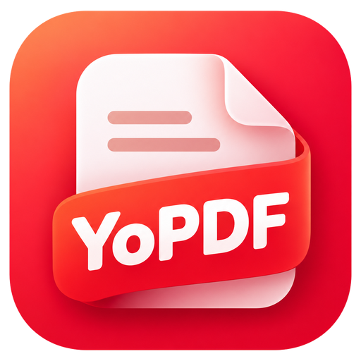

<h1 align="center">
  <br>
  <small><small>YoPDF</small></small>
</h1>

<p align="center">
  A free, open-source, local-first PDF reader and annotator for macOS and Windows,<br>
  built natively for each platform. <strong>Your PDF. Your way.</strong>
</p>

YoPDF is in early development. The repository currently contains the macOS
reader: opening a local PDF, continuous scrolling, page navigation, zoom, and
standard PDF Highlight/Underline/Note annotations, including illustrated
sticker notes, with automatic saving for committed annotation edits. Full-text
PDF search is available; AI-assisted reading is not implemented yet.

## Design constraints

- **Local-first.** Reading and annotating must work without a network, an
  account, or a model.
- **Native.** SwiftUI + AppKit + PDFKit on macOS; WinUI 3 + PDFium is the
  candidate for Windows, still to be validated.
- **Standard formats.** Annotations are written as standard PDF annotations so
  other readers can open the result. Application-specific data is kept separate
  and is never required to render a document.
- **Untrusted input.** PDFs are data, never instructions.

## Repository layout

```
macos/
├── project.yml        # XcodeGen spec (the .xcodeproj is generated)
├── YoPDFCore/         # reader logic, no UI, unit-tested
├── YoPDF/             # SwiftUI app + sticker Asset Catalog
├── YoPDFTests/        # logic tests
├── YoPDFUITests/      # macOS GUI regression tests
└── scripts/           # generate / build / test / test-ui
```

## License

Apache-2.0. See [LICENSE](LICENSE).

Third-party dependencies, fonts, and sample documents require their own
provenance review before redistribution. The YoPDF name and logo are not
covered by the source license. The sticker illustration provenance and runtime
hashes are recorded in [STICKER_ASSETS_MANIFEST.md](STICKER_ASSETS_MANIFEST.md);
that file is a technical inventory, not a separate license.
