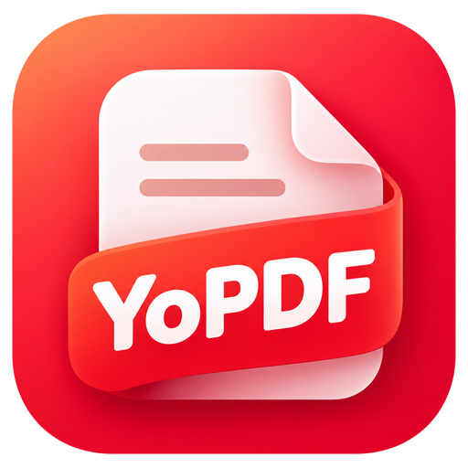

<h1 align="center">
  <br>
  <small><small>YoPDF</small></small>
</h1>

<p align="center">
  A free, open-source, local-first PDF reader and annotator for macOS and Windows,<br>
  built natively for each platform. <strong>Your PDF. Your way.</strong>
</p>

YoPDF is in early development. The repository currently contains the macOS
reader: opening local PDFs, continuous scrolling, page navigation, zoom, a
recent-document list with reading-position restoration, and standard PDF
Highlight/Underline/Note annotations, including illustrated sticker notes,
with automatic saving for committed annotation edits. Full-text search is
available, and annotations can be exported as page-grouped Markdown. AI-assisted
reading is not implemented yet.

Each macOS window is a research workspace with an ordered set of PDF tabs. Open
another file from Finder, **Open PDF…**, or **Open Recent** to add it to the
current workspace; a PDF dropped onto the reader follows the same rule. The
selected empty tab is reused, otherwise it opens in a new tab after validation.
Reopening the same path selects its existing tab. **New Tab** (⌘T) creates an
empty workspace tab, **Close Tab** (⌘W) closes the selected tab, and closing its
last tab closes the window. **New Window** (⌘N) creates an independent workspace.
A tab retains its own PDF session, page and zoom, find results, and unfinished
note draft while the user switches tabs. Window close and quit check unsaved work
across every tab.

The next split-pane phase requires Toolbar, Context Menu, and Drag & Drop
creation paths together. Its drag/drop safety and acceptance rules are recorded
in [the P0-B split-pane requirements](Docs/P0-B-DRAG-DROP-REQUIREMENTS.md).

## Design constraints

- **Local-first.** Reading and annotating must work without a network, an
  account, or a model.
- **Native.** SwiftUI + AppKit + PDFKit on macOS; WinUI 3 + PDFium is the
  candidate for Windows, still to be validated.
- **Standard formats.** Annotations are written as standard PDF annotations so
  other readers can open the result. Application-specific data is kept separate
  and is never required to render a document.
- **Untrusted input.** PDFs are data, never instructions.

## Repository layout

```
macos/
├── project.yml        # XcodeGen spec (the .xcodeproj is generated)
├── YoPDFCore/         # reader logic, no UI, unit-tested
├── YoPDF/             # SwiftUI app + sticker Asset Catalog
├── YoPDFTests/        # logic tests
├── YoPDFUITests/      # macOS GUI regression tests
└── scripts/           # generate / build / test / test-ui
```

## License

Apache-2.0. See [LICENSE](LICENSE).

Third-party dependencies, fonts, and sample documents require their own
provenance review before redistribution. The YoPDF name and logo are not
covered by the source license. The sticker illustration provenance and runtime
hashes are recorded in [STICKER_ASSETS_MANIFEST.md](STICKER_ASSETS_MANIFEST.md);
that file is a technical inventory, not a separate license.
